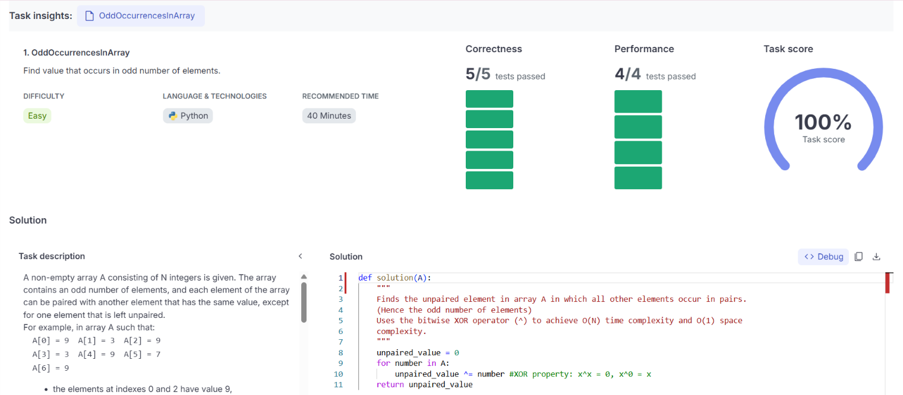
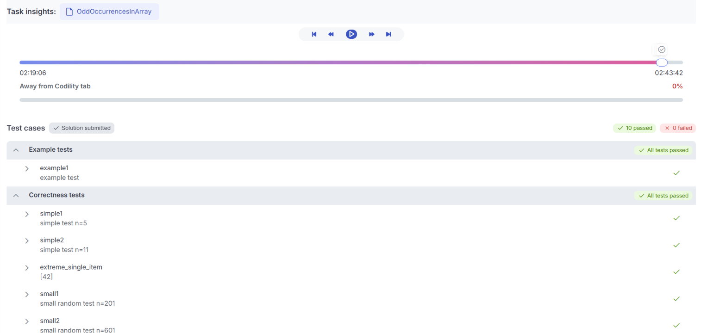

# PROBLEM #1: OddOccurencesInArray
def solution(A):
    """
    Finds the unpaired element in array A in which all other elements occur in pairs.
    (Hence the odd number of elements)
    Uses the bitwise XOR operator (^) to achieve O(N) time complexity and O(1) space 
    complexity.
    """
    unpaired_value = 0
    for number in A:
        unpaired_value ^= number #XOR property: x^x = 0, x^0 = x
    return unpaired_value

# TEST RESULTS:

# PROBLEM #2: PermMissingElem
def solution(A):
    """
    Finds the single missing integer in an array containing N distinct elements in the  
    range [1,...,(N+1)].
    """
    N = len(A)
    expected_max = N + 1
    # Sum formula for integers 1 to N+1
    total_sum = expected_max*(expected_max + 1) //2
    actual_sum = sum(A)

    return total_sum - actual_sum

# TEST RESULTS

# PROBLEM #3: PermCheck
def solution(A):
    """
    Checks if array A is a valid permutation of integers from 1 to N.
    Returns 1 if valid, 0 if not.
    """
    N = len(A)
    elements_set = set()

    for number in A:
        #Checks if out of valid permutation range
        if number < 1 or number > N:
            return 0
        elements_set.add(number)

    #Valid permutations must have N unique elements matching range [1,...,N]
    if len(elements_set) == N:
        return 1
    else:
        return 0

# TEST RESULTS

# PROBLEM #4: PassingCars
def solution(A):
    """
    Counts pairs of passing cars where 0 represents a car going east, and 1 represents a 
    car going west.
    Returns -1 if pairs exceed 1,000,000,000.
    """
    east_count = 0
    passing_pairs = 0

    for car in A:
        if car == 0:
            east_count += 1
        else:
            #Westbound car passes all eastbound cars we've seen so far
            passing_pairs += east_count
            if passing_pairs > 1_000_000_000:
                return -1

    return passing_pairs

# TEST RESULTS

# PROBLEM #5: CountDiv
def solution(A, B, K):
    
    divisible_at_B = B // K
    divisible_below_A = (A - 1) // K

    return divisible_at_B - divisible_below_A

# TEST RESULTS

